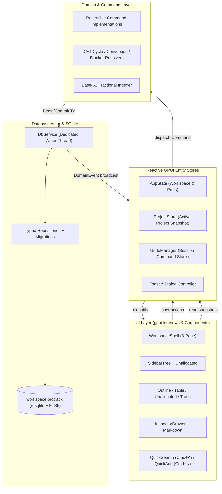

# ProTrack — Rust & GPUI Architecture (`ARCHITECTURE.md`)

> **Companion Specs**: [README](./README.md) · [Product Specification](./PRODUCT_SPEC.md) · [Data Model & SQLite Spec](./DATA_MODEL.md) · [UI & Interaction Spec](./UI_SPEC.md)

---

## 1. Layered System Architecture

ProTrack uses a clean, single-process desktop architecture with **zero external async runtimes** (no Tokio). Background SQLite I/O runs on a dedicated single-writer OS thread coordinated with GPUI's built-in foreground/background executors.



---

## 2. Recommended `Cargo.toml` Dependencies

```toml
[package]
name = "protrack4"
version = "0.1.0"
edition = "2024"

[dependencies]
gpui-kit = "0.7"
rusqlite = { version = "0.32", features = ["bundled", "chrono", "uuid"] }
uuid = { version = "1", features = ["v7", "serde"] }
serde = { version = "1", features = ["derive"] }
serde_json = "1"
chrono = { version = "0.4", features = ["serde"] }
directories = "5"
thiserror = "2"
tracing = "0.1"
tracing-subscriber = { version = "0.3", features = ["env-filter"] }
fs4 = "0.12"
crossbeam-channel = "0.5"
oneshot = "0.1"

[dev-dependencies]
proptest = "1"
tempfile = "3"
```

---

## 3. Proposed `src/` Directory Layout

```text
src/
├── main.rs                    # App entrypoint, logging, CLI --db override, GPUI launch
├── domain/
│   ├── mod.rs
│   ├── types.rs               # Strong IDs, Project, Item, Assignee, Tag, Status, Priority
│   ├── blockers.rs            # EffectiveBlockState, BlockerWarning, DAG validation helpers
│   ├── conversion.rs          # ConversionEligibility & ConversionBlockReason
│   ├── progress.rs            # FeatureProgress rollup calculations
│   ├── fractional_index.rs    # Base-62 midpoint & sibling rebalancing
│   └── error.rs               # DomainError enum with user-friendly messages
├── db/
│   ├── mod.rs
│   ├── actor.rs               # DbService single-writer thread + channel request/response
│   ├── migrations.rs          # Schema version check, .bak backup, embedded 001_initial.sql
│   ├── project_repo.rs        # Project CRUD, key_prefix rename cascade
│   ├── item_repo.rs           # Tree, Unallocated, Table queries, FTS5 search, Trash/Restore
│   ├── blocker_repo.rs        # Cycle detection CTEs, blocker add/remove, effective state
│   ├── assignee_repo.rs       # Global Assignee CRUD + archive
│   └── tag_repo.rs            # Project Tag CRUD + item_tags
├── commands/
│   ├── mod.rs
│   ├── undo_manager.rs        # Session Undo/Redo stacks (max 100 entries)
│   ├── item_commands.rs       # Create, UpdateFields, Reorder, MoveFeature, SetFeatures
│   ├── blocker_commands.rs    # AddBlocker, RemoveBlocker
│   ├── conversion_commands.rs # ConvertWorkItemToFeature, ConvertFeatureToWorkItem
│   ├── trash_commands.rs      # TrashSubtree, RestoreTrashRoot
│   └── meta_commands.rs       # Project / Assignee / Tag mutations
├── workspace/
│   ├── mod.rs
│   ├── manager.rs             # Open/Create/Switch/Close .protrack, fs4 lock, WAL flush
│   └── preferences.rs         # OS app-data preferences.json (recent files, theme, layout)
├── state/
│   ├── mod.rs
│   ├── app_state.rs           # GPUI Global/Entity managing active workspace & preferences
│   └── project_store.rs       # Cached snapshot for active Project (tree, blockers, rollups)
└── ui/
    ├── mod.rs
    ├── shell.rs               # 3-pane desktop layout + top toolbar
    ├── sidebar.rs             # Project switcher, Unallocated row, Feature Tree, Trash/Meta
    ├── outline_view.rs        # Hierarchical outline view + inline add + DnD
    ├── table_view.rs          # Filtered DataTable view + filter pill bar
    ├── unallocated_view.rs    # Dedicated Triage inbox
    ├── trash_view.rs          # Grouped Trash & Restore view
    ├── inspector.rs           # Right inspector drawer + strict Convert + Markdown preview
    └── modals/
        ├── quick_search.rs    # Cmd+K FTS5 search & action palette
        ├── quick_add.rs       # Cmd+N contextual item creation modal
        ├── workspace_modal.rs # Welcome / Switch / New .protrack workspace
        └── managers.rs        # Project Settings, Assignees Manager, Tags Manager
```

---

## 4. Core Rust Domain Types

```rust
use chrono::{DateTime, Utc};
use serde::{Deserialize, Serialize};
use uuid::Uuid;

pub const MAX_FEATURE_DEPTH: usize = 32;

macro_rules! define_id {
    ($name:ident) => {
        #[derive(Debug, Clone, Copy, PartialEq, Eq, Hash, PartialOrd, Ord, Serialize, Deserialize)]
        pub struct $name(pub Uuid);
        impl $name {
            pub fn new() -> Self { Self(Uuid::now_v7()) }
        }
    };
}

define_id!(ProjectId);
define_id!(ItemId);
define_id!(AssigneeId);
define_id!(TagId);

#[derive(Debug, Clone, Copy, PartialEq, Eq, Serialize, Deserialize)]
#[serde(rename_all = "snake_case")]
pub enum ProjectStatus { Active, Paused, Completed, Archived }

#[derive(Debug, Clone, Copy, PartialEq, Eq, Serialize, Deserialize)]
#[serde(rename_all = "snake_case")]
pub enum ItemKind { Feature, WorkItem }

#[derive(Debug, Clone, Copy, PartialEq, Eq, Serialize, Deserialize)]
#[serde(rename_all = "snake_case")]
pub enum ItemStatus { Backlog, Todo, InProgress, Done, Cancelled }

#[derive(Debug, Clone, Copy, PartialEq, Eq, PartialOrd, Ord, Serialize, Deserialize)]
#[serde(rename_all = "snake_case")]
pub enum Priority { None, Low, Medium, High, Urgent }

#[derive(Debug, Clone, PartialEq, Eq)]
pub enum EffectiveBlockState {
    Unblocked,
    DirectlyBlocked { active_count: usize },
    InheritedBlocked { ancestor_blocker_count: usize },
    PartiallyBlocked { blocked_features: usize, total_features: usize },
}

#[derive(Debug, Clone, PartialEq, Eq)]
pub enum BlockerWarning {
    Cancelled { blocker_id: ItemId, blocker_key: String, title: String },
    InTrash { blocker_id: ItemId, blocker_key: String, title: String },
}

#[derive(Debug, Clone, PartialEq, Eq)]
pub enum ConversionBlockReason {
    HasChildFeatures(usize),
    HasAttachedWorkItems(usize),
    HasActiveDependents(usize),
    AttachedToMultipleFeatures(usize),
    ExceedsMaxFeatureDepth { max_depth: usize },
}

#[derive(Debug, Clone, PartialEq, Eq)]
pub enum ConversionEligibility {
    Allowed {
        target_kind: ItemKind,
        resulting_parent: Option<ItemId>,
        moves_to_unallocated: bool,
    },
    Blocked(Vec<ConversionBlockReason>),
}

#[derive(Debug, Clone, PartialEq)]
pub struct FeatureProgress {
    pub work_items_done: usize,
    pub work_items_total: usize,
    pub child_features_done: usize,
    pub child_features_total: usize,
    /// `None` when both non-cancelled Work Items and child Features are 0.
    pub ratio: Option<f32>,
}
```

---

## 5. Database Actor & GPUI Concurrency Model

GPUI renders on a single UI thread and provides `cx.background_executor()`. Instead of adding Tokio or sharing an `Arc<Mutex<Connection>>` across threads (which risks UI frame drops on lock contention), ProTrack isolates SQLite behind a **single-writer `DbService` actor**:

1. **Dedicated Thread**: When a `.protrack` workspace is opened, `WorkspaceManager` spawns one OS thread (`"protrack-db-actor"`) owning the `rusqlite::Connection`.
2. **Typed Channel Dispatch**: UI/GPUI callers enqueue `DbRequest` payloads (containing either a read query or a `Box<dyn UndoableCommand>`) with a `oneshot::Sender<Result<T, DomainError>>`.
3. **Non-Blocking Await in GPUI**: `ProjectStore` uses `cx.spawn(async move |this, cx| ...)` to await the `oneshot` receiver off the UI thread, then updates the cached `ProjectSnapshot` inside `this.update(cx, ...)` and calls `cx.notify()`.
4. **Coalesced Reactive Invalidation**: After every committed write transaction, the actor emits a `DomainEvent`:
   ```rust
   pub enum DomainEvent {
       WorkspaceSwitched,
       ProjectsChanged,
       ItemsChanged { project_id: ProjectId },
       TrashChanged { project_id: ProjectId },
       AssigneesChanged,
       TagsChanged { project_id: ProjectId },
   }
   ```
   `ProjectStore` listens to `DomainEvent`s and refreshes the materialized in-memory view snapshot (Feature tree, Unallocated list, effective block map, feature progress rollups, tag map) cleanly in one batched read pass—typically `< 2 ms` for thousands of items.

---

## 6. Session Undo/Redo Architecture (`UndoManager`)

Every user mutation goes through a reversible `Command` executed inside a single `BEGIN IMMEDIATE ... COMMIT` SQLite transaction:

```rust
pub trait UndoableCommand: Send + Sync {
    /// Human-readable label for toast & menu, e.g. "Convert PRO-12 to Feature"
    fn label(&self) -> String;

    /// Apply forward mutation inside active SQLite transaction, returning reverse snapshot.
    fn execute(&mut self, tx: &rusqlite::Transaction<'_>) -> Result<CommandEffect, DomainError>;

    /// Revert mutation cleanly inside active SQLite transaction.
    fn undo(&mut self, tx: &rusqlite::Transaction<'_>) -> Result<CommandEffect, DomainError>;
}
```

### Snapshot Strategy per Command

| Command | Captured Undo Snapshot |
| :--- | :--- |
| `CreateItem` | Created `ItemId` (undo runs hard `DELETE FROM items WHERE id = ?`, rolling back `next_item_seq` if it was the latest) |
| `UpdateItemFields` | Prior field values (`title`, `description`, `status`, `priority`, `assignee_id`, `updated_at`) |
| `ReorderItems` | Vector of `(id_or_fwi_pair, old_sort_order)` before midpoint/rebalance |
| `ReparentFeature` | Prior `(parent_feature_id, sort_order)` |
| `SetWorkItemFeatures` | Prior `Vec<(feature_id, sort_order)>` + prior `items.sort_order` |
| `AddBlocker` / `RemoveBlocker` | Exact `(project_id, blocked_item_id, blocker_feature_id, created_at)` row |
| `ConvertWorkItemToFeature` | Prior `(kind, parent_feature_id, sort_order)` + full snapshot of all deleted `feature_work_items` rows (active + stale trashed links) |
| `ConvertFeatureToWorkItem` | Prior `(kind, parent_feature_id, sort_order)` + any pruned stale links from trashed rows (`items.parent_feature_id`, `feature_work_items`, `item_blockers`) + created `feature_work_items` link to `old_parent_id` |
| `TrashItemSubtree` | Exact set of item IDs marked `deleted_at` with `trash_root_id` (undo clears `deleted_at` & `trash_root_id` only on those captured IDs) |
| `RestoreTrashRoot` | Exact set of restored item IDs + any `parent_feature_id` or conflicting blocker adjusted during restore |

- **Stack Capacity**: `MAX_UNDO_DEPTH = 100` entries per session.
- **Stack Reset Rules**: Undo & Redo stacks are cleared whenever switching workspaces, permanently purging items from Trash, or emptying Trash (so Undo never references permanently deleted rows).
- **UI Feedback**: Triggering `Cmd+Z` / `Cmd+Shift+Z` shows a brief subtle toast (`"Undid: Convert PRO-12 to Feature"`).

---

## 7. Workspace Management & Preferences

### 7.1 Local Preferences (`preferences.json`)
Stored at OS standard app config directory via `directories::ProjectDirs::from("io", "protrack", "protrack4")`:
- macOS: `~/Library/Application Support/io.protrack.protrack4/preferences.json`

```json
{
  "last_workspace_path": "/Users/mark/Documents/ProTrack/work.protrack",
  "recent_workspaces": [
    { "path": "/Users/mark/Documents/ProTrack/work.protrack", "name": "Work", "last_opened": "2026-11-23T01:00:00Z" }
  ],
  "theme": "system",
  "sidebar_width": 260,
  "inspector_width": 380,
  "sidebar_collapsed": false,
  "inspector_open": true,
  "active_project_by_workspace": {}
}
```

### 7.2 Startup & Shutdown Flow
1. Parse optional `--db <path>` CLI flag (useful for tests/dev without altering `recent_workspaces` unless desired).
2. Otherwise try `last_workspace_path` if file still exists.
3. If no workspace exists or file was moved/deleted, open **Workspace Welcome Modal** (`Create New Workspace…`, `Open Existing .protrack…`, or pick from valid `recent_workspaces`).
4. On open: acquire `fs4` advisory lock → check `schema_version` → backup & migrate if older → switch SQLite to `WAL`.
5. On close / workspace switch: `DbService` runs `PRAGMA wal_checkpoint(TRUNCATE); PRAGMA journal_mode = DELETE;`, releases advisory lock, and flushes `preferences.json`.

---

## 8. 4-Layer Testing & Verification Strategy

1. **Layer 1 — SQLite Invariants & Schema Triggers (`cargo test db::`)**:
   - In-memory SQLite tests covering every invariant `INV-01` through `INV-15`.
   - Explicitly test SQLite rejecting cross-project FKs, Work Items as blockers, `kind` flips with remaining references, cycle detection CTEs across mixed hierarchy+blocker loops, multi-feature Trash sparing shared Work Items, and `FTS5` sync triggers.
2. **Layer 2 — Command & Undo/Redo Round-Trip Tests (`cargo test commands::`)**:
   - For every `UndoableCommand`: assert DB snapshot $S_0 \xrightarrow{\text{execute}} S_1 \xrightarrow{\text{undo}} S_0 \xrightarrow{\text{redo}} S_1$ with byte-for-byte relational equality (including `ConvertWorkItemToFeature`, `ConvertFeatureToWorkItem`, and `TrashItemSubtree`).
3. **Layer 3 — Property-Based State-Machine Fuzzing (`proptest`)**:
   - Generate random sequences of 500+ operations (`create_feature`, `create_wi`, `attach`, `detach`, `reparent`, `add_blocker`, `convert`, `trash`, `restore`, `undo`, `redo`).
   - Assert after **every** step: zero cycles in combined graph $G$, zero cross-project links, zero depth `>= 32`, and strict conversion guards match SQLite state.
4. **Layer 4 — `gpui-kit` Headless UI Integration Tests**:
   - Test `ProjectStore` + View state transitions (switching projects resets selection cleanly, Unallocated count updates immediately after drag/allocate, Inspector Convert button tooltip lists exact `ConversionBlockReason` items).
