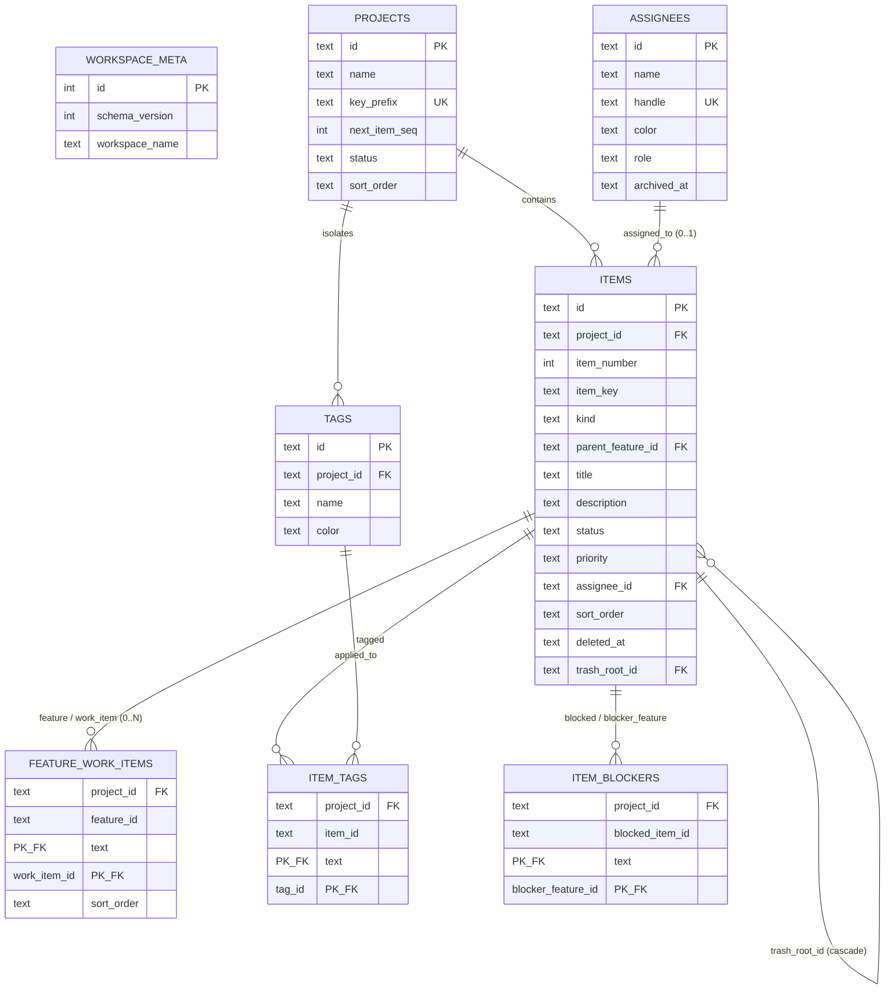

# ProTrack — Data Model & SQLite Specification (`DATA_MODEL.md`)

> **Companion Specs**: [README](./README.md) · [Product Specification](./PRODUCT_SPEC.md) · [Rust & GPUI Architecture](./ARCHITECTURE.md) · [UI & Interaction Spec](./UI_SPEC.md)

---

## 1. Architectural Rationale

ProTrack's SQLite schema is built around three deliberate database-level guarantees:

1. **Unified `items` Table (`kind IN ('feature', 'work_item')`)**:
   Storing Features and Work Items in one `items` table guarantees that `id` (UUIDv7) and `item_key` (`PRO-12`) never change during `Feature ↔ Work Item` conversion, keeps foreign keys uniform for `item_tags` and `item_blockers`, and enables a single external-content FTS5 index across both kinds.
2. **Composite Foreign Keys `(id, project_id)` Everywhere**:
   Rather than relying solely on application checks for strict Project isolation (`INV-01`), `tags`, `items`, `feature_work_items`, `item_tags`, and `item_blockers` all carry `project_id` and declare composite foreign keys referencing `(id, project_id)`. SQLite rejects any cross-project link at the storage engine level.
3. **Kind & Conversion Integrity Triggers**:
   SQLite `BEFORE INSERT` / `BEFORE UPDATE` triggers enforce `INV-04` (only Features can be blockers or parents) and prevent `kind` flips whenever referencing links remain, keeping the database structurally consistent even outside the Rust domain service.

---

## 2. Entity-Relationship Diagram



---

## 3. Complete Executable SQLite DDL (`migrations/001_initial.sql`)

> **Important SQLite Constraints**:
> - `items` intentionally retains `rowid` (must **NOT** use `WITHOUT ROWID`) because `items_fts` is an external-content FTS5 virtual table bound via `content='items', content_rowid='rowid'`.
> - All relational tables use `STRICT` typing (requires SQLite ≥ 3.37, guaranteed by `rusqlite` `bundled`).
> - Case-insensitive uniqueness on `tags(project_id, name)` and `assignees(handle)` is enforced via `CREATE UNIQUE INDEX ... COLLATE NOCASE`.

```sql
-- ============================================================================
-- ProTrack Migration 001: Initial Schema
-- Target: SQLite 3.45+ (bundled via rusqlite)
-- ============================================================================

PRAGMA foreign_keys = ON;

-- ----------------------------------------------------------------------------
-- 1. Workspace Metadata
-- ----------------------------------------------------------------------------
CREATE TABLE workspace_meta (
    id INTEGER PRIMARY KEY CHECK (id = 1),
    schema_version INTEGER NOT NULL CHECK (schema_version >= 1),
    app_min_version TEXT NOT NULL DEFAULT '0.1.0',
    workspace_name TEXT NOT NULL DEFAULT 'Personal Workspace' CHECK (length(trim(workspace_name)) > 0),
    created_at TEXT NOT NULL,
    updated_at TEXT NOT NULL
) STRICT;

-- ----------------------------------------------------------------------------
-- 2. Projects (Strict Isolation Boundary)
-- ----------------------------------------------------------------------------
CREATE TABLE projects (
    id TEXT PRIMARY KEY,
    name TEXT NOT NULL CHECK (length(trim(name)) > 0),
    key_prefix TEXT NOT NULL CHECK (
        length(key_prefix) BETWEEN 2 AND 10
        AND key_prefix GLOB '[A-Z][A-Z0-9]*'
    ),
    next_item_seq INTEGER NOT NULL DEFAULT 1 CHECK (next_item_seq >= 1),
    description TEXT NOT NULL DEFAULT '',
    color TEXT NOT NULL DEFAULT '#6366F1',
    status TEXT NOT NULL DEFAULT 'active' CHECK (status IN ('active', 'paused', 'completed', 'archived')),
    sort_order TEXT NOT NULL,
    created_at TEXT NOT NULL,
    updated_at TEXT NOT NULL
) STRICT;

CREATE UNIQUE INDEX idx_projects_key_prefix ON projects(key_prefix);
CREATE INDEX idx_projects_status_sort ON projects(status, sort_order);

-- ----------------------------------------------------------------------------
-- 3. Local Assignees (Global Across Workspace)
-- ----------------------------------------------------------------------------
CREATE TABLE assignees (
    id TEXT PRIMARY KEY,
    name TEXT NOT NULL CHECK (length(trim(name)) > 0),
    handle TEXT NOT NULL CHECK (length(trim(handle)) BETWEEN 1 AND 8),
    color TEXT NOT NULL DEFAULT '#64748B',
    role TEXT,
    notes TEXT NOT NULL DEFAULT '',
    archived_at TEXT,
    created_at TEXT NOT NULL,
    updated_at TEXT NOT NULL
) STRICT;

CREATE UNIQUE INDEX idx_assignees_handle ON assignees(handle COLLATE NOCASE);
CREATE INDEX idx_assignees_active ON assignees(archived_at, name);

-- ----------------------------------------------------------------------------
-- 4. Project-Scoped Tags
-- ----------------------------------------------------------------------------
CREATE TABLE tags (
    id TEXT PRIMARY KEY,
    project_id TEXT NOT NULL REFERENCES projects(id) ON DELETE CASCADE,
    name TEXT NOT NULL CHECK (length(trim(name)) > 0),
    color TEXT NOT NULL DEFAULT '#8B5CF6',
    created_at TEXT NOT NULL,
    UNIQUE (id, project_id)
) STRICT;

CREATE UNIQUE INDEX idx_tags_project_name ON tags(project_id, name COLLATE NOCASE);

-- ----------------------------------------------------------------------------
-- 5. Unified Items Table (Features & Work Items)
-- Note: Must keep implicit rowid for FTS5 external content binding.
-- ----------------------------------------------------------------------------
CREATE TABLE items (
    id TEXT PRIMARY KEY,
    project_id TEXT NOT NULL REFERENCES projects(id) ON DELETE CASCADE,
    item_number INTEGER NOT NULL CHECK (item_number >= 1),
    item_key TEXT NOT NULL CHECK (length(trim(item_key)) > 0),
    kind TEXT NOT NULL CHECK (kind IN ('feature', 'work_item')),
    parent_feature_id TEXT,
    title TEXT NOT NULL CHECK (length(trim(title)) > 0),
    description TEXT NOT NULL DEFAULT '',
    status TEXT NOT NULL DEFAULT 'todo' CHECK (
        status IN ('backlog', 'todo', 'in_progress', 'done', 'cancelled')
    ),
    priority TEXT NOT NULL DEFAULT 'none' CHECK (
        priority IN ('none', 'low', 'medium', 'high', 'urgent')
    ),
    assignee_id TEXT REFERENCES assignees(id) ON DELETE SET NULL,
    sort_order TEXT NOT NULL,
    deleted_at TEXT,
    trash_root_id TEXT,
    created_at TEXT NOT NULL,
    updated_at TEXT NOT NULL,

    UNIQUE (id, project_id),
    UNIQUE (project_id, item_number),
    UNIQUE (project_id, item_key),

    -- Composite FKs guarantee same-project containment (MATCH SIMPLE skips NULLs)
    FOREIGN KEY (parent_feature_id, project_id)
        REFERENCES items(id, project_id) ON DELETE CASCADE,
    FOREIGN KEY (trash_root_id, project_id)
        REFERENCES items(id, project_id) ON DELETE CASCADE,

    CHECK (
        (kind = 'work_item' AND parent_feature_id IS NULL)
        OR (kind = 'feature' AND (parent_feature_id IS NULL OR parent_feature_id != id))
    ),
    CHECK (
        (deleted_at IS NULL AND trash_root_id IS NULL)
        OR (deleted_at IS NOT NULL AND trash_root_id IS NOT NULL)
    )
) STRICT;

CREATE INDEX idx_items_project_active
    ON items(project_id, deleted_at, kind, parent_feature_id, sort_order);
CREATE INDEX idx_items_parent_feature
    ON items(parent_feature_id) WHERE parent_feature_id IS NOT NULL;
CREATE INDEX idx_items_trash_root
    ON items(trash_root_id) WHERE trash_root_id IS NOT NULL;
CREATE INDEX idx_items_assignee
    ON items(assignee_id) WHERE assignee_id IS NOT NULL;
CREATE INDEX idx_items_project_status
    ON items(project_id, status) WHERE deleted_at IS NULL;

-- ----------------------------------------------------------------------------
-- 6. Feature <-> Work Item Many-to-Many Attachment Table
-- Active work items with 0 rows here belong to the Project's Unallocated bucket.
-- ----------------------------------------------------------------------------
CREATE TABLE feature_work_items (
    project_id TEXT NOT NULL,
    feature_id TEXT NOT NULL,
    work_item_id TEXT NOT NULL,
    sort_order TEXT NOT NULL,
    created_at TEXT NOT NULL,

    PRIMARY KEY (feature_id, work_item_id),
    FOREIGN KEY (feature_id, project_id)
        REFERENCES items(id, project_id) ON DELETE CASCADE,
    FOREIGN KEY (work_item_id, project_id)
        REFERENCES items(id, project_id) ON DELETE CASCADE
) STRICT;

CREATE INDEX idx_fwi_work_item ON feature_work_items(work_item_id);
CREATE INDEX idx_fwi_feature_order ON feature_work_items(feature_id, sort_order);

-- ----------------------------------------------------------------------------
-- 7. Item <-> Tag Attachment Table (Same-Project Enforced)
-- ----------------------------------------------------------------------------
CREATE TABLE item_tags (
    project_id TEXT NOT NULL,
    item_id TEXT NOT NULL,
    tag_id TEXT NOT NULL,
    created_at TEXT NOT NULL,

    PRIMARY KEY (item_id, tag_id),
    FOREIGN KEY (item_id, project_id)
        REFERENCES items(id, project_id) ON DELETE CASCADE,
    FOREIGN KEY (tag_id, project_id)
        REFERENCES tags(id, project_id) ON DELETE CASCADE
) STRICT;

CREATE INDEX idx_item_tags_tag ON item_tags(tag_id);

-- ----------------------------------------------------------------------------
-- 8. Blocking Dependencies Table (Features-Only Targets, Same-Project Enforced)
-- ----------------------------------------------------------------------------
CREATE TABLE item_blockers (
    project_id TEXT NOT NULL,
    blocked_item_id TEXT NOT NULL,
    blocker_feature_id TEXT NOT NULL,
    created_at TEXT NOT NULL,

    PRIMARY KEY (blocked_item_id, blocker_feature_id),
    CHECK (blocked_item_id != blocker_feature_id),
    FOREIGN KEY (blocked_item_id, project_id)
        REFERENCES items(id, project_id) ON DELETE CASCADE,
    FOREIGN KEY (blocker_feature_id, project_id)
        REFERENCES items(id, project_id) ON DELETE CASCADE
) STRICT;

CREATE INDEX idx_blockers_blocker ON item_blockers(blocker_feature_id);

-- ----------------------------------------------------------------------------
-- 9. Structural Integrity Triggers (Kind & Conversion Enforcement)
-- ----------------------------------------------------------------------------

-- Parent of a feature must be a feature
CREATE TRIGGER trg_items_parent_is_feature_ins
BEFORE INSERT ON items
WHEN NEW.parent_feature_id IS NOT NULL
BEGIN
    SELECT RAISE(ABORT, 'INV-02 violation: parent_feature_id must reference a feature')
    WHERE NOT EXISTS (
        SELECT 1 FROM items WHERE id = NEW.parent_feature_id AND kind = 'feature'
    );
END;

CREATE TRIGGER trg_items_parent_is_feature_upd
BEFORE UPDATE OF parent_feature_id ON items
WHEN NEW.parent_feature_id IS NOT NULL
BEGIN
    SELECT RAISE(ABORT, 'INV-02 violation: parent_feature_id must reference a feature')
    WHERE NOT EXISTS (
        SELECT 1 FROM items WHERE id = NEW.parent_feature_id AND kind = 'feature'
    );
END;

-- feature_work_items must connect a feature to a work_item
CREATE TRIGGER trg_fwi_kinds_ins
BEFORE INSERT ON feature_work_items
BEGIN
    SELECT RAISE(ABORT, 'INV-03 violation: feature_id must have kind=feature')
    WHERE NOT EXISTS (
        SELECT 1 FROM items WHERE id = NEW.feature_id AND kind = 'feature'
    );
    SELECT RAISE(ABORT, 'INV-03 violation: work_item_id must have kind=work_item')
    WHERE NOT EXISTS (
        SELECT 1 FROM items WHERE id = NEW.work_item_id AND kind = 'work_item'
    );
END;

CREATE TRIGGER trg_fwi_kinds_upd
BEFORE UPDATE OF feature_id, work_item_id ON feature_work_items
BEGIN
    SELECT RAISE(ABORT, 'INV-03 violation: feature_id must have kind=feature')
    WHERE NOT EXISTS (
        SELECT 1 FROM items WHERE id = NEW.feature_id AND kind = 'feature'
    );
    SELECT RAISE(ABORT, 'INV-03 violation: work_item_id must have kind=work_item')
    WHERE NOT EXISTS (
        SELECT 1 FROM items WHERE id = NEW.work_item_id AND kind = 'work_item'
    );
END;

-- item_blockers target must always be a feature (INV-04)
CREATE TRIGGER trg_blockers_kind_ins
BEFORE INSERT ON item_blockers
BEGIN
    SELECT RAISE(ABORT, 'INV-04 violation: blocker_feature_id must have kind=feature')
    WHERE NOT EXISTS (
        SELECT 1 FROM items WHERE id = NEW.blocker_feature_id AND kind = 'feature'
    );
END;

CREATE TRIGGER trg_blockers_kind_upd
BEFORE UPDATE OF blocker_feature_id ON item_blockers
BEGIN
    SELECT RAISE(ABORT, 'INV-04 violation: blocker_feature_id must have kind=feature')
    WHERE NOT EXISTS (
        SELECT 1 FROM items WHERE id = NEW.blocker_feature_id AND kind = 'feature'
    );
END;

-- Guard kind conversions unless referencing structural links were resolved first
CREATE TRIGGER trg_items_kind_guard_upd
BEFORE UPDATE OF kind ON items
WHEN OLD.kind != NEW.kind
BEGIN
    -- Feature -> Work Item requires 0 child features, 0 attached work items, 0 dependents
    SELECT RAISE(ABORT, 'INV-09 violation: cannot convert feature with child features')
    WHERE OLD.kind = 'feature' AND NEW.kind = 'work_item'
      AND EXISTS (SELECT 1 FROM items WHERE parent_feature_id = OLD.id);

    SELECT RAISE(ABORT, 'INV-09 violation: cannot convert feature with attached work items')
    WHERE OLD.kind = 'feature' AND NEW.kind = 'work_item'
      AND EXISTS (SELECT 1 FROM feature_work_items WHERE feature_id = OLD.id);

    SELECT RAISE(ABORT, 'INV-09 violation: cannot convert feature referenced as a blocker')
    WHERE OLD.kind = 'feature' AND NEW.kind = 'work_item'
      AND EXISTS (SELECT 1 FROM item_blockers WHERE blocker_feature_id = OLD.id);

    -- Work Item -> Feature requires clearing feature_work_items links first
    SELECT RAISE(ABORT, 'INV-08 violation: must migrate/clear feature_work_items before converting to feature')
    WHERE OLD.kind = 'work_item' AND NEW.kind = 'feature'
      AND EXISTS (SELECT 1 FROM feature_work_items WHERE work_item_id = OLD.id);
END;

-- ----------------------------------------------------------------------------
-- 10. Full-Text Search (FTS5 External Content)
-- ----------------------------------------------------------------------------
CREATE VIRTUAL TABLE items_fts USING fts5(
    item_key,
    title,
    description,
    content='items',
    content_rowid='rowid',
    tokenize='unicode61 remove_diacritics 2'
);

CREATE TRIGGER trg_items_fts_ai AFTER INSERT ON items BEGIN
    INSERT INTO items_fts(rowid, item_key, title, description)
    VALUES (NEW.rowid, NEW.item_key, NEW.title, NEW.description);
END;

CREATE TRIGGER trg_items_fts_ad AFTER DELETE ON items BEGIN
    INSERT INTO items_fts(items_fts, rowid, item_key, title, description)
    VALUES ('delete', OLD.rowid, OLD.item_key, OLD.title, OLD.description);
END;

CREATE TRIGGER trg_items_fts_au AFTER UPDATE OF item_key, title, description ON items BEGIN
    INSERT INTO items_fts(items_fts, rowid, item_key, title, description)
    VALUES ('delete', OLD.rowid, OLD.item_key, OLD.title, OLD.description);
    INSERT INTO items_fts(rowid, item_key, title, description)
    VALUES (NEW.rowid, NEW.item_key, NEW.title, NEW.description);
END;
```

---

## 4. Canonical SQL Queries & Recursive CTEs

All queries below assume `PRAGMA foreign_keys = ON;` and `MAX_FEATURE_DEPTH = 32` (`depth` `0..=31`).

### 4.1 Project Feature Tree Traversal
Returns all active Features in a Project with tree `depth` and lexicographic `sort_path` for deterministic depth-first outline ordering:

```sql
WITH RECURSIVE feature_tree AS (
    SELECT
        id,
        project_id,
        parent_feature_id,
        item_key,
        title,
        status,
        priority,
        assignee_id,
        sort_order,
        0 AS depth,
        sort_order AS sort_path
    FROM items
    WHERE project_id = :project_id
      AND kind = 'feature'
      AND parent_feature_id IS NULL
      AND deleted_at IS NULL

    UNION ALL

    SELECT
        c.id,
        c.project_id,
        c.parent_feature_id,
        c.item_key,
        c.title,
        c.status,
        c.priority,
        c.assignee_id,
        c.sort_order,
        ft.depth + 1 AS depth,
        ft.sort_path || '/' || c.sort_order AS sort_path
    FROM items c
    JOIN feature_tree ft ON c.parent_feature_id = ft.id
    WHERE c.kind = 'feature'
      AND c.deleted_at IS NULL
      AND ft.depth < 31
)
SELECT * FROM feature_tree
ORDER BY sort_path ASC;
```

### 4.2 Unallocated Bucket Query
Returns all active Work Items in a Project with **zero active attached Features** (`INV-03`):

```sql
SELECT i.*
FROM items i
WHERE i.project_id = :project_id
  AND i.kind = 'work_item'
  AND i.deleted_at IS NULL
  AND NOT EXISTS (
      SELECT 1
      FROM feature_work_items fwi
      JOIN items f ON f.id = fwi.feature_id
      WHERE fwi.work_item_id = i.id
        AND f.deleted_at IS NULL
  )
ORDER BY i.sort_order ASC;
```

### 4.3 Combined DAG Cycle & Exclusion Detection (`INV-05`)

#### A. Validate `add_blocker(blocked_item_id, blocker_feature_id)`
Before inserting `(blocked_item_id, blocker_feature_id)`:
1. Verify same `project_id` and `blocker.kind = 'feature'`.
2. **If `blocked_item` is a Work Item**: check `blocker_feature_id` is NOT an active attached Feature of `blocked_item` nor an ancestor of any active attached Feature:
```sql
WITH RECURSIVE attached_ancestors(feature_id, depth) AS (
    SELECT fwi.feature_id, 0
    FROM feature_work_items fwi
    JOIN items f ON f.id = fwi.feature_id
    WHERE fwi.work_item_id = :blocked_item_id
      AND f.deleted_at IS NULL
    UNION
    SELECT p.parent_feature_id, aa.depth + 1
    FROM items p
    JOIN attached_ancestors aa ON p.id = aa.feature_id
    WHERE p.parent_feature_id IS NOT NULL
      AND aa.depth < 32
)
SELECT EXISTS (
    SELECT 1 FROM attached_ancestors WHERE feature_id = :blocker_feature_id
) AS violates_exclusion;
```
3. **If `blocked_item` is a Feature**:
   - Check `blocker_feature_id` is neither an ancestor nor a descendant of `blocked_item_id`.
   - Check combined graph reachability: adding edge `blocked_item_id -> blocker_feature_id` creates a cycle iff `blocked_item_id` is already reachable from `blocker_feature_id` in $E = \text{hierarchy}(c \to p) \cup \text{blockers}(b \to r)$:
```sql
WITH RECURSIVE combined_reach(node_id, depth) AS (
    SELECT :blocker_feature_id, 0
    UNION
    SELECT next_id, cr.depth + 1
    FROM (
        SELECT i.id AS from_id, i.parent_feature_id AS next_id
        FROM items i
        WHERE i.project_id = :project_id
          AND i.kind = 'feature'
          AND i.parent_feature_id IS NOT NULL
        UNION ALL
        SELECT ib.blocked_item_id AS from_id, ib.blocker_feature_id AS next_id
        FROM item_blockers ib
        JOIN items b ON b.id = ib.blocked_item_id
        WHERE ib.project_id = :project_id
          AND b.kind = 'feature'
    ) edges
    JOIN combined_reach cr ON edges.from_id = cr.node_id
    WHERE cr.depth < 64
),
ancestors(id, depth) AS (
    SELECT :blocked_item_id, 0
    UNION
    SELECT i.parent_feature_id, a.depth + 1
    FROM items i JOIN ancestors a ON i.id = a.id
    WHERE i.parent_feature_id IS NOT NULL AND a.depth < 32
),
descendants(id, depth) AS (
    SELECT :blocked_item_id, 0
    UNION
    SELECT c.id, d.depth + 1
    FROM items c JOIN descendants d ON c.parent_feature_id = d.id
    WHERE d.depth < 32
)
SELECT
    EXISTS (SELECT 1 FROM combined_reach WHERE node_id = :blocked_item_id) AS creates_cycle,
    (
        EXISTS (SELECT 1 FROM ancestors WHERE id = :blocker_feature_id)
        OR EXISTS (SELECT 1 FROM descendants WHERE id = :blocker_feature_id)
    ) AS is_ancestor_or_descendant;
```

#### B. Validate `reparent_feature(feature_id, new_parent_id)`
When `new_parent_id IS NOT NULL`:
1. Check `new_parent_id` is not `feature_id` and not a descendant of `feature_id`.
2. Check subtree height fits inside `MAX_FEATURE_DEPTH = 32`: `(depth(new_parent_id) + 1) + max_subtree_offset(feature_id) < 32`.
3. Check combined graph reachability: adding edge `feature_id -> new_parent_id` creates a cycle iff `feature_id` is reachable from `new_parent_id` in $E$.
4. Check Work Item exclusion (`INV-05`): no Feature in `{new_parent_id} ∪ ancestors(new_parent_id)` is directly blocked by any Feature in `subtree(feature_id)` or any Work Item attached to a Feature in `subtree(feature_id)`, AND no Feature in `subtree(feature_id)` is directly blocked on `{new_parent_id} ∪ ancestors(new_parent_id)`.

### 4.4 Transitive & Partial Effective Blocking (`INV-06`, `INV-07`)
Computes active direct blockers, inherited blockers through ancestor Features, cancelled/trashed warnings, and Work Item partial-block status for all active items in a Project:

```sql
WITH RECURSIVE feature_ancestors(feature_id, ancestor_id, hop) AS (
    SELECT id, parent_feature_id, 1
    FROM items
    WHERE project_id = :project_id
      AND kind = 'feature'
      AND parent_feature_id IS NOT NULL
      AND deleted_at IS NULL
    UNION ALL
    SELECT fa.feature_id, p.parent_feature_id, fa.hop + 1
    FROM feature_ancestors fa
    JOIN items p ON p.id = fa.ancestor_id
    WHERE p.parent_feature_id IS NOT NULL
      AND p.deleted_at IS NULL
      AND fa.hop < 32
),
direct_blockers AS (
    SELECT
        ib.blocked_item_id AS item_id,
        b.id AS blocker_id,
        b.item_key AS blocker_key,
        b.title AS blocker_title,
        b.status AS blocker_status,
        b.deleted_at AS blocker_deleted_at,
        (b.deleted_at IS NULL AND b.status NOT IN ('done', 'cancelled')) AS is_active_block
    FROM item_blockers ib
    JOIN items b ON b.id = ib.blocker_feature_id
    WHERE ib.project_id = :project_id
),
feature_effective AS (
    SELECT
        f.id AS feature_id,
        EXISTS (
            SELECT 1 FROM direct_blockers db
            WHERE db.item_id = f.id AND db.is_active_block = 1
        ) AS has_direct_block,
        EXISTS (
            SELECT 1 FROM feature_ancestors fa
            JOIN direct_blockers db ON db.item_id = fa.ancestor_id
            WHERE fa.feature_id = f.id AND db.is_active_block = 1
        ) AS has_inherited_block
    FROM items f
    WHERE f.project_id = :project_id
      AND f.kind = 'feature'
      AND f.deleted_at IS NULL
),
work_item_feature_stats AS (
    SELECT
        wi.id AS work_item_id,
        COUNT(fe.feature_id) AS attached_feature_count,
        COALESCE(SUM(CASE WHEN fe.has_direct_block OR fe.has_inherited_block THEN 1 ELSE 0 END), 0) AS blocked_feature_count
    FROM items wi
    LEFT JOIN feature_work_items fwi ON fwi.work_item_id = wi.id
    LEFT JOIN feature_effective fe ON fe.feature_id = fwi.feature_id
    WHERE wi.project_id = :project_id
      AND wi.kind = 'work_item'
      AND wi.deleted_at IS NULL
    GROUP BY wi.id
)
SELECT
    i.id,
    i.kind,
    CASE
        WHEN EXISTS (SELECT 1 FROM direct_blockers db WHERE db.item_id = i.id AND db.is_active_block = 1)
            THEN 'directly_blocked'
        WHEN i.kind = 'feature' AND EXISTS (
            SELECT 1 FROM feature_effective fe WHERE fe.feature_id = i.id AND fe.has_inherited_block = 1
        )
            THEN 'inherited_blocked'
        WHEN i.kind = 'work_item' AND wfs.attached_feature_count > 0 AND wfs.blocked_feature_count = wfs.attached_feature_count
            THEN 'inherited_blocked'
        WHEN i.kind = 'work_item' AND wfs.blocked_feature_count > 0 AND wfs.blocked_feature_count < wfs.attached_feature_count
            THEN 'partially_blocked'
        ELSE 'unblocked'
    END AS effective_block_state
FROM items i
LEFT JOIN work_item_feature_stats wfs ON wfs.work_item_id = i.id
WHERE i.project_id = :project_id
  AND i.deleted_at IS NULL;
```

### 4.5 Deduplicated Subtree Progress Roll-up (`INV-11`)
Computes accurate completion counts per Feature, counting each shared Work Item **at most once** per ancestor Feature subtree and excluding `cancelled` items from denominators:

```sql
WITH RECURSIVE feature_closure(root_id, descendant_id, hop) AS (
    SELECT id, id, 0
    FROM items
    WHERE project_id = :project_id
      AND kind = 'feature'
      AND deleted_at IS NULL
    UNION ALL
    SELECT fc.root_id, c.id, fc.hop + 1
    FROM feature_closure fc
    JOIN items c ON c.parent_feature_id = fc.descendant_id
    WHERE c.kind = 'feature'
      AND c.deleted_at IS NULL
      AND fc.hop < 31
),
distinct_subtree_wis AS (
    SELECT DISTINCT
        fc.root_id AS feature_id,
        wi.id AS work_item_id,
        wi.status AS wi_status
    FROM feature_closure fc
    JOIN feature_work_items fwi ON fwi.feature_id = fc.descendant_id
    JOIN items wi ON wi.id = fwi.work_item_id
    WHERE wi.deleted_at IS NULL
      AND wi.status != 'cancelled'
),
wi_rollup AS (
    SELECT
        feature_id,
        COUNT(*) AS wi_total,
        SUM(CASE WHEN wi_status = 'done' THEN 1 ELSE 0 END) AS wi_done
    FROM distinct_subtree_wis
    GROUP BY feature_id
),
descendant_feature_rollup AS (
    SELECT
        fc.root_id AS feature_id,
        COUNT(*) AS feat_total,
        SUM(CASE WHEN df.status = 'done' THEN 1 ELSE 0 END) AS feat_done
    FROM feature_closure fc
    JOIN items df ON df.id = fc.descendant_id
    WHERE fc.hop > 0
      AND df.status != 'cancelled'
    GROUP BY fc.root_id
)
SELECT
    f.id AS feature_id,
    COALESCE(w.wi_done, 0) AS work_items_done,
    COALESCE(w.wi_total, 0) AS work_items_total,
    COALESCE(d.feat_done, 0) AS child_features_done,
    COALESCE(d.feat_total, 0) AS child_features_total,
    CASE
        WHEN COALESCE(w.wi_total, 0) > 0 THEN CAST(w.wi_done AS REAL) / w.wi_total
        WHEN COALESCE(d.feat_total, 0) > 0 THEN CAST(d.feat_done AS REAL) / d.feat_total
        ELSE NULL
    END AS completion_ratio
FROM items f
LEFT JOIN wi_rollup w ON w.feature_id = f.id
LEFT JOIN descendant_feature_rollup d ON d.feature_id = f.id
WHERE f.project_id = :project_id
  AND f.kind = 'feature'
  AND f.deleted_at IS NULL;
```

### 4.6 Atomic Conversion Transactions (`INV-08`, `INV-09`)

#### A. Work Item → Feature (`BEGIN IMMEDIATE ... COMMIT`)
1. Query active attached features (`f.deleted_at IS NULL`). Abort if count `> 1`.
2. If count `= 1`, let `parent_id = single_active_feature_id`; verify `depth(parent_id) + 1 < 32`. Else `parent_id = NULL`.
3. Snapshot and **delete all `feature_work_items` rows** for `work_item_id` (both active link if `1` and any stale links to trashed features — saved in `UndoSnapshot`).
4. Compute new `sort_order` at the end of root Features (if `parent_id IS NULL`) or children of `parent_id`.
5. Execute `UPDATE items SET kind = 'feature', parent_feature_id = :parent_id, sort_order = :new_sort, updated_at = :now WHERE id = :id;` (satisfies `trg_items_kind_guard_upd`).

#### B. Feature → Work Item (`BEGIN IMMEDIATE ... COMMIT`)
1. Verify strict guard (`INV-09`):
   - `0` active child Features (`deleted_at IS NULL`),
   - `0` active attached Work Items (`wi.deleted_at IS NULL`),
   - `0` active dependents (`blocked.deleted_at IS NULL`).
2. Snapshot and clean up any stale references from **trashed** items pointing to `:id`:
   - `UPDATE items SET parent_feature_id = NULL WHERE parent_feature_id = :id AND deleted_at IS NOT NULL;`
   - `DELETE FROM feature_work_items WHERE feature_id = :id;` (already verified `0` active WIs)
   - `DELETE FROM item_blockers WHERE blocker_feature_id = :id;` (already verified `0` active dependents)
3. Read `old_parent_id = items.parent_feature_id` before clearing it.
4. Execute `UPDATE items SET kind = 'work_item', parent_feature_id = NULL, sort_order = :new_wi_sort, updated_at = :now WHERE id = :id;`.
5. If `old_parent_id IS NOT NULL`, insert `(project_id, old_parent_id, :id, :new_fwi_sort, :now)` into `feature_work_items` so the converted Work Item stays inside its former parent Feature! (If `old_parent_id IS NULL`, it naturally enters the **Unallocated** bucket.)

### 4.7 Cascade Trash & Shared Work Item Protection (`INV-12`)

```sql
-- Inside BEGIN IMMEDIATE ... COMMIT when trashing root item :target_id at :now
WITH RECURSIVE target_subtree(id, depth) AS (
    SELECT id, 0 FROM items WHERE id = :target_id AND deleted_at IS NULL
    UNION ALL
    SELECT c.id, ts.depth + 1
    FROM items c
    JOIN target_subtree ts ON c.parent_feature_id = ts.id
    WHERE c.deleted_at IS NULL AND ts.depth < 32
),
exclusively_owned_wis AS (
    SELECT DISTINCT fwi.work_item_id AS id
    FROM feature_work_items fwi
    JOIN items wi ON wi.id = fwi.work_item_id
    WHERE fwi.feature_id IN (SELECT id FROM target_subtree)
      AND wi.deleted_at IS NULL
      AND NOT EXISTS (
          SELECT 1
          FROM feature_work_items other_fwi
          JOIN items other_f ON other_f.id = other_fwi.feature_id
          WHERE other_fwi.work_item_id = wi.id
            AND other_f.deleted_at IS NULL
            AND other_f.id NOT IN (SELECT id FROM target_subtree)
      )
)
UPDATE items
SET deleted_at = :now,
    trash_root_id = :target_id,
    updated_at = :now
WHERE id IN (
    SELECT id FROM target_subtree
    UNION
    SELECT id FROM exclusively_owned_wis
);
```

### 4.8 Quick Search (`Cmd+K`) — FTS5 + Key Prefix Lookup

```sql
SELECT
    i.id,
    i.item_key,
    i.kind,
    i.title,
    i.status,
    i.priority,
    bm25(items_fts, 10.0, 5.0, 1.0) AS rank
FROM items_fts
JOIN items i ON i.rowid = items_fts.rowid
WHERE items_fts MATCH :fts_query
  AND i.project_id = :project_id
  AND i.deleted_at IS NULL
ORDER BY
    CASE WHEN upper(i.item_key) = upper(:raw_query) THEN 0 ELSE 1 END,
    rank ASC
LIMIT 50;
```

---

## 5. Fractional Indexing Specification

Manual ordering (`projects.sort_order`, `items.sort_order`, `feature_work_items.sort_order`) uses **Base-62 lexicographic fractional indexing** (`0–9`, `A–Z`, `a–z`, ASCII sorted).

- **Alphabet**: `0123456789ABCDEFGHIJKLMNOPQRSTUVWXYZabcdefghijklmnopqrstuvwxyz` (62 characters).
- **Initial / First Item**: `"V"` (midpoint of alphabet).
- **Append to End**: Midpoint between `last_key` and upper sentinel (`~` virtual bound).
- **Prepend to Start**: Midpoint between lower sentinel (`""`) and `first_key`.
- **Insert Between `a` and `b` (`a < b`)**: Compute shortest lexicographic string `m` such that `a < m < b`.
- **Rebalance Trigger**: Whenever a newly generated key exceeds **32 bytes** in length, the Rust repository triggers an in-transaction sibling rebalance (assigning clean evenly-spaced 2–3 character keys to all siblings in that scope).

---

## 6. Workspace File Lifecycle, Migrations & Cloud-Sync Hardening

Because `.protrack` files may reside inside **iCloud Drive, Dropbox, or Google Drive** folders:

1. **Advisory File Locking**: On opening `workspace.protrack`, ProTrack acquires an exclusive OS-level advisory lock via `fs4` on a companion `.protrack.lock` (or directly on the file handle where supported) and warns clearly if another ProTrack instance already holds the file open.
2. **Session WAL Mode**: Immediately upon open:
   ```sql
   PRAGMA foreign_keys = ON;
   PRAGMA journal_mode = WAL;
   PRAGMA synchronous = NORMAL;
   PRAGMA busy_timeout = 3000;
   ```
3. **Clean Shutdown & Switch Checkpoint**: Before closing or switching workspaces (and on graceful `SIGINT`/window close), ProTrack collapses `-wal` and `-shm` back into the single `.protrack` file so cloud sync tools upload an atomic, self-contained SQLite file:
   ```sql
   PRAGMA wal_checkpoint(TRUNCATE);
   PRAGMA journal_mode = DELETE;
   ```
4. **Schema Migrations & Safety**:
   - Schema version stored in `workspace_meta.schema_version` (and mirrored to `PRAGMA user_version`).
   - **Forward-version guard**: If `file_version > APP_MAX_SCHEMA_VERSION`, refuse to mutate and show a clear *"This workspace was created by a newer version of ProTrack"* dialog.
   - **Pre-migration backup**: Before running any migration `N -> N+1`, copy `foo.protrack` to `foo.protrack.v{N}.bak` atomically alongside the file before beginning the migration transaction.
